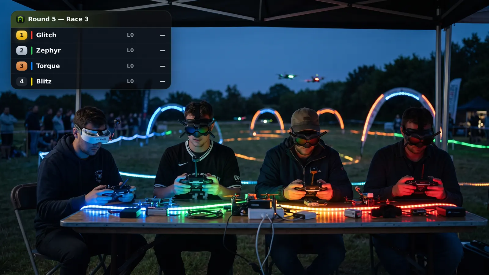
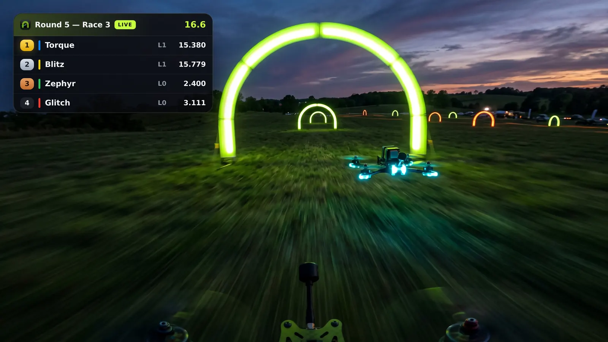
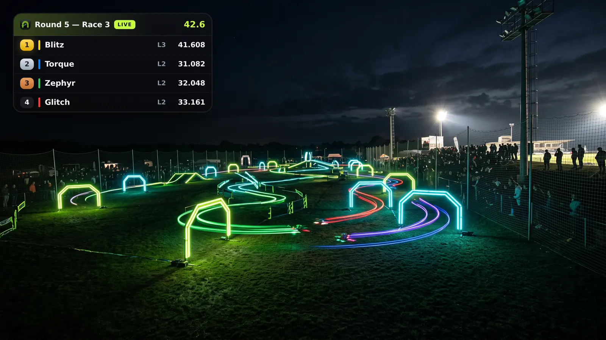

<p align="center"></p>

# dd-pits

**A race-day companion for [FPVTrackside](https://github.com/FPVTrackside).**
dd-pits runs on the timing laptop next to FPVTrackside and turns its timing
data into everything else a race director wants on the day: a live dashboard
pilots can open on their phones, OBS overlays, spoken race calls, AI
commentary, and lap times in pilots' goggles via an ELRS backpack.

It runs entirely on the venue laptop and needs no internet connection or
account. Everything is configured in a browser and stored in one JSON file
beside the binary.

**[Website](https://dd-pits.threedigitalllamas.com.au)** ·
**[Live demo](https://demo.dd-pits.threedigitalllamas.com.au)** ·
**[Download](../../releases)** ·
[ELRS Netpack](https://github.com/bob9/elrs-netpack)

[](https://buymeacoffee.com/bobnine)


## Screenshots

| | |
| --- | --- |
|  **TV view** (`/live`): the current race, full-screen. |  **OBS overlay** (`/overlay`): a broadcast panel for your stream. |
|  **Pilot pages:** stats, lap chart and every lap of the meeting. |  **Race history:** every heat with its lap times. |
|  **Commentary booth:** choose a writer, a voice and a style. |  **Goggle pilots:** one bind phrase per pilot. |
|  **Race calls:** decide who speaks the lap times. |  **First run:** the board lights up when FPVTrackside does. |

### OBS overlay examples

Add `/overlay` to OBS as a Browser Source (1920×1080). The background is
transparent, and the overlay follows every heat on its own:

| On the grid | Racing | Final lap |
| --- | --- | --- |
|  |  |  |

<p align="center"><br><em>Every pilot can follow along on their phone.</em></p>

## Features

### Dashboard and displays

- **Live dashboard** (`/`): the current heat, who's next, standings, best
  consecutive laps and time trials. Anyone on the venue wifi can open it on
  their phone, and it updates live without refreshing.
- **Pilot pages** (`/dronedash/pilot?name=…`): per-pilot analytics, with stat
  cards that jump to the heat that set them, a lap chart, and lap and race
  tables. Everything is rendered on the laptop, so it works offline.
- **Race history** (`/dronedash/races`): every heat with its lap times.
- **TV view** (`/live`): the current race full-screen, for a screen at the
  pits.
- **OBS overlay** (`/overlay`): add it as a Browser Source.
- **Practice rounds** show on the board but don't count towards standings.
- **Slow displays:** add `?lite=1` to any page for an old TV or tablet that
  struggles.

### Race calls

- **One voice for every call:** laps, holeshots, results and "next up" can be
  spoken by dd-pits instead of FPVTrackside's own speech.
- **Your club's wording:** calls are read from FPVTrackside's own
  `Sounds.xml`, so the phrasing and on/off switches you set there carry over.
  dd-pits finds FPVTrackside's files itself, and an audit flags settings that
  disagree.
- **One switch decides who speaks.** dd-pits sets FPVTrackside's speech volume
  to match, so you never hear both or neither. If no voice is set up,
  FPVTrackside keeps speaking and dd-pits stays out of the audio.
- **Fast calls:** dd-pits listens for FPVTrackside's live events as well as
  polling it. Voice packs of pre-generated clips make common calls play
  instantly.
- **Race director controls** (`/calls`): Hurry Up, Announce Race and the
  other calls FPVTrackside binds to keyboard shortcuts. Trigger them from the
  laptop or any phone at the field.
- **Pronunciations:** tell the voice how to say a tricky callsign without
  changing how it's spelled anywhere else.
- When the operator moves to the next race, anything still waiting to be said
  about the last one is dropped.

### Commentary booth

- **AI commentary:** play-by-play and colour written from the live timing
  data. Commentary and race calls share one audio bus, so a lap call always
  cuts in instead of waiting behind colour.
- **Choose where it runs:**
  - Writer: a local model on Apple Silicon (MLX), Google Gemini, or Qwen.
  - Voice: a local cloned voice (Qwen3-TTS on MLX), or Qwen3-TTS over the
    network.
  - Mix and match. `/setup/models` checks the machine and installs the local
    models for you.
- **Your own commentator:** clone a voice from a recording you upload, or
  record one straight in the browser. Qwen can also design a voice from a
  description.
- **Style:** personality, humour, energy, language and accent. Commentary can
  be solo or a two-person duo, and you choose which phases (before, during and
  after the race) and which moments it talks about.
- **Hearing it:** play it through the laptop's speakers, or add `/booth.wav` to
  OBS as a Media Source. With the OBS websocket connected, dd-pits delays the
  video automatically so the commentary stays in sync, and can add the audio to
  every scene.
- **Cost tracking:** the `/booth` page shows the session's AI spend and recent
  on-air lines.
- **Model host mode** (`-model-host` / `-model-url`): a Windows race PC can
  borrow a Mac's GPU over the LAN.

### Goggles (ELRS backpack)

- **On-screen info:** lap times and race info appear in pilots' goggles. Each
  pilot needs only a bind phrase; dd-pits derives the goggle ID from it.
- **DVR names:** recordings are named after the heat.
- **Clock sync:** the goggle clock is set correctly.
- **Configurable screen:** the OSD layout is set at `/setup/osd`, with an
  optional custom layout per pilot.
- **Goggle control** (`/goggles`): change a pilot's video channel from the
  desk, or send a message to some or all pilots.
- **Connection:** an [ELRS Netpack](#works-with-elrs-netpack) on the venue
  network (it can confirm delivery), a USB backpack, or netpack with USB
  fallback.

### After the race

- **Watch links:** paste a YouTube stream address and place one heat on the
  timeline. Every heat then gets a ▶ Watch link, and dd-pits builds a chapter
  list to paste into the video description.
- **Commentary after the fact:** generate commentary for finished heats, and
  the Watch player plays it over the muted video, in sync as you scrub.

### Running it

- **Browser setup:** everything is configured at `/setup`, with a guided
  first run and help at `/setup/help`. Settings are stored in one JSON file you
  can copy to another laptop.
- **Debug page** (`/setup/debug`): the log in the browser, with API keys
  removed, plus a downloadable report to send when something goes wrong.
- **JSON API** (`/docs`): meeting, race, round, leaderboard, pilot and channel
  data as JSON, with an OpenAPI spec and a live event stream, for building
  your own displays.

## Works with ELRS Netpack

[**ELRS Netpack**](https://github.com/bob9/elrs-netpack) is open-source
firmware that turns an Ethernet-equipped ESP32 board into an ExpressLRS timer
backpack you reach over the network instead of a USB cable. dd-pits talks to it
over TCP (port `8080`, found at `elrs-netpack.local`), and it relays goggle
messages to every pilot at the field. That covers lap times on the OSD, DVR
names, clock sync and channel changes.

- **One cable:** on a PoE board (Waveshare ESP32-S3-ETH PoE, Olimex
  ESP32-POE-ISO) a single Ethernet cable powers the netpack and connects it.
  Put it anywhere on the venue network, not tethered to the timing laptop.
- **Delivery confirmation:** the netpack reports back whether each message
  reached the goggles, so dd-pits knows a pilot actually got it.
- **Over-the-air updates:** browse to `http://elrs-netpack.local/` and drop in
  a new firmware file. No USB needed after the first flash.
- **Goggle test console** (`/test`): send an OSD message, change a channel,
  set the clock or name a DVR recording from any browser. Useful for checking
  a pilot's goggles before the meeting starts.

| Firmware console | Goggle test console |
| --- | --- |
|  |  |

Set it up in dd-pits at `/setup/backpack`: choose **Network (netpack)** and
enter its name or address. ELRS Netpack was originally created by
[i-am-grub](https://github.com/i-am-grub/elrs-netpack), and is forked and
extended by [bob9](https://github.com/bob9/elrs-netpack). It is not affiliated
with the ExpressLRS project.

## Quick start

1. Download the binary for your platform from
   [Releases](../../releases), or build it yourself (see below).
2. Start FPVTrackside and open your event.
3. Run `dd-pits`. With no arguments it serves on port `8088` and opens the
   setup guide in your browser on first run.
4. Open `http://localhost:8088/` to check the dashboard can see your event,
   then work through `http://localhost:8088/setup`.

The in-app help at `/setup/help` covers race-day setup in detail.

### Settings and flags

Settings are saved to `dd-pits-local.json` beside the binary. Copy that file to
another laptop to move the whole setup. Every setting can also be given as a
command-line flag or `DD_PITS_*` environment variable, and a flag always wins
over the file. Run `dd-pits -h` for the full list. The ones you are most likely
to need:

| Flag | Default | Purpose |
| --- | --- | --- |
| `-fpvtrackside` | `http://localhost:8080` | Where FPVTrackside's web server is |
| `-serve-addr` | `:8088` | Address for dd-pits' own pages |
| `-setup-pin` | (none) | Allow changing settings from another device with `?pin=…` |
| `-race-audio` | off | Speak FPVTrackside's race calls from dd-pits |
| `-booth` | off | Run the AI commentary booth |
| `-elrs` | off | Enable the ELRS backpack |
| `-audio-out` | off | Play the audio bus on this machine's speakers |

The settings pages accept changes only from the laptop itself. The dashboard is
open to the whole venue network, so this stops a phone in the pits from
changing someone's goggle channel. Use `-setup-pin` if you need to configure
from another device.

### Local AI models (optional)

Local voice and local commentary need **Apple Silicon** and a Python
environment with `mlx-audio` (voice) and/or `mlx-lm` (writer). The
`/setup/models` page checks what is installed and can install the models for
you. Playing through the laptop's speakers needs `sounddevice`. The Python
sidecar scripts are embedded in the binary and written out beside it at
startup.

On other hardware, use a Gemini or Qwen API key for the writer and voice, or
point `-model-url` at a Mac running `dd-pits -model-host :9099`.

## Building

You need Go 1.25 or later.

```sh
make build          # ./bin/dd-pits for this machine
make test           # go vet + go test
make release        # cross-compile for macOS, Windows and Linux into ./dist
```

On macOS, in-process audio uses CGo (`ebitengine/oto`). Cross-compiled builds
fall back to the Python audio sidecar.

### Developing without a timing system

`cmd/fpvtrackside-sim` serves a simulated FPVTrackside meeting over the same
API dd-pits reads. Heats are staged, raced and finished back to back in real
time, so every page has live data to show:

```sh
go run ./cmd/fpvtrackside-sim -addr 127.0.0.1:8080 &
go run ./cmd/dd-pits -fpvtrackside http://127.0.0.1:8080
```

The [live demo](https://demo.dd-pits.threedigitalllamas.com.au) runs exactly
this.

## Project layout

```
cmd/dd-pits/         the application: poller, local web server, setup pages,
                     race calls, commentary booth, ELRS controller
internal/dronedash/  FPVTrackside client and snapshot model
internal/ddapi/      the JSON read API served at /docs
internal/booth/      commentary prompt building and style
internal/elrs/       ELRS backpack protocol (serial + netpack)
internal/tts/        speech engines (local MLX sidecar, Gemini, Qwen)
internal/gemini/     Gemini client (AI Studio key or Vertex AI)
internal/qwenchat/   Qwen chat client (commentary writer)
internal/qwentts/    Qwen3-TTS client
internal/localchat/  local MLX chat model sidecar
cmd/fpvtrackside-sim/ simulated FPVTrackside meeting for development and demos
site/                the promo website (dd-pits.threedigitalllamas.com.au)
docs/                design notes and screenshots
```

## Contributing

Issues and pull requests are welcome. Run `make test` before sending a PR. If
you change anything that touches race-day timing (the poll loop, race calls or
the audio bus), say how you tested it against a real or recorded FPVTrackside
event.

## Support

dd-pits is free and built in spare time between race days. If it makes your
club's events run smoother, you can help keep it going at
**[buymeacoffee.com/bobnine](https://buymeacoffee.com/bobnine)** ☕

## License

[MIT](LICENSE)
